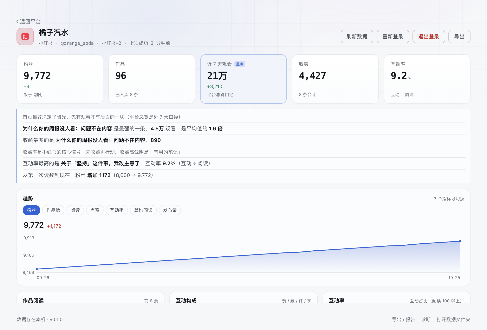

<p align="right"><a href="README.md">简体中文</a> | <strong>English</strong></p>

# Account Monitor

    

> By **Labulaka** (GitHub [@labulaka-ai](https://github.com/labulaka-ai))

[Install](#install) · [Why](#why-i-built-this) · [What it does](#what-it-does) · [One account, one environment](#one-account-one-environment) · [What it refuses to do](#what-it-refuses-to-do) · [Where the data lives](#where-the-data-lives) · [Run from source](#run-from-source) · [Tech choices](#tech-choices) · [Confidence](#confidence-tests-and-real-run-fixes) · [Known limits](#known-limits) · [License](#license)

A **fully local** archive for your multi-platform account numbers. Built for people who run several platforms at once and would rather not hand their data to a third party:

**12 platforms, one isolated browser environment per account, data that never leaves your Mac.**

WeChat Official Accounts · Xiaohongshu · Douyin · WeChat Channels · Weibo · Zhihu · Bilibili · X · YouTube · Instagram · Threads · TikTok

<picture>
  <source media="(prefers-color-scheme: dark)" srcset="docs/home-dark.png">
  
</picture>

> Every account, nickname and number in the screenshots is synthetic demo data.

---

## Install

Grab the build for your Mac from [Releases](https://github.com/labulaka-ai/account-monitor/releases) and drag it into Applications:

| Your Mac | Download |
|---|---|
| Apple silicon (M1–M4) | `账号监控-0.1.0-mac-arm64.dmg` |
| Intel | `账号监控-0.1.0-mac-x64.dmg` |

**The first launch will be blocked by macOS**, because the app is not signed with an Apple Developer certificate (that is $99/year; this is a personal project). The app is not broken. Either:

```bash
xattr -dr com.apple.quarantine /Applications/账号监控.app
```

or right-click the app in Applications → **Open** → **Open** again. After that, double-clicking works.

Only use builds from this repository's Releases, and check the hash if you care:

```bash
shasum -a 256 ~/Downloads/账号监控-0.1.0-mac-arm64.dmg
```

The SHA-256 is in the matching Release notes.

## Why I built this

Dashboard numbers are **liquid** — yesterday's read count is overwritten by next week's. What a creator actually needs is "how did that post from three months ago actually do", but every dashboard only shows right now.

So people screenshot and retype, and then:

- **The numbers disagree.** The same post can show different read counts in the creator centre, the analytics panel and the mobile app — and change again a week later. You stop knowing which one to trust.
- **Cross-platform comparison is impossible.** Seven platforms, seven dashboards. Answering "which platform likes this topic more" means stitching screenshots together, and they are already stale by the time you finish.
- **The data isn't yours.** Almost every third-party tool wants you to authorise your account to *their* server. Once your session is handed over, what you can see and what they can see are no longer symmetric.

This tool does one thing: **copies the numbers out of each dashboard once a day and keeps them on your own disk.** "How did that post do three months ago" becomes a query; "which platform pays off" becomes a chart.

## What it does

| Capability | Detail |
|---|---|
| **12 platform readers** | One adapter per platform: account-level numbers, the works list, and per-work reads / likes / saves / comments / shares. Fields it cannot parse stay empty — it does not guess |
| **Daily snapshots** | Followers, cumulative reads, cumulative likes, work count — one row per day. The trend chart plots real history, not a re-sample |
| **Per-work archive** | Title, publish time and every measurement ever read are kept. Works deleted upstream are flagged `gone` rather than pretending they never existed |
| **Per-platform analysis** | Each platform gets conclusions in its own vocabulary (Xiaohongshu cares about save rate, WeChat Official Accounts about recommendation share) — not one template applied to all |
| **Reports** | Markdown / HTML / Word (`.docx` written by hand, no Office required) |
| **MCP server** | Optional, off by default. Lets a local AI read your data; binds `127.0.0.1` with a Bearer token |
| **Light / dark** | Follows the system or locked manually |

## One account, one environment

Every account gets its own Electron session partition (`persist:acct-<platform>-<n>`): cookies, localStorage and cache fully isolated.

This is not for convenience — it is **anti-crosstalk**. Log two accounts into one browser environment and the data merges, in the invisible way: **the numbers are real but belong to the other account.** No amount of staring at the numbers will reveal it.

So isolation is layered: before writing, the reader compares an **identity anchor** (nickname plus uid/avatar, captured on first successful read) and refuses to write on mismatch; the UI prints `nickname · @handle` on both the card and the detail page so a human can confirm which account they are looking at.

## What it refuses to do

These are design red lines, encoded in the source and stated here:

| Never | Why |
|---|---|
| **Never logs you in** | Login is yours alone. No form filling, no passkey clicking, no password guessing |
| **Never posts, likes or follows** | Any "I'll do it for you" action risks tripping platform risk control. That is account safety, not a missing feature |
| **Never polls hard** | Hard minimum intervals per platform (20 min for Douyin / Xiaohongshu, 15 min for the rest), timed from the moment a page opens. When throttled the UI stays calm and tells you how many minutes are left |
| **Never uploads anything** | No server, no accounts, no telemetry. Works offline |

The throttling is not politeness: platform risk scoring is a black box, and one trip can cost you weeks of warm-up. Better to read less often.

## Where the data lives

| Environment | Location |
|---|---|
| `npm start` | `data/monitor.db` inside the project |
| Packaged app | `~/Library/Application Support/account-monitor/data/monitor.db` |

A single SQLite file (Node's built-in `node:sqlite`, nothing to install). **Backup = copy that one file**; a timestamped copy is made automatically before every schema migration.

Cookies are not in that file. They live in each platform's partition directory (`…/Partitions/acct-*`), managed by Chromium — deleting a partition logs that account out.

## Run from source

Requires Node 22.5+ (`node:sqlite` lands there).

```bash
git clone https://github.com/labulaka-ai/account-monitor.git
cd account-monitor
npm install     # only electron; no other runtime dependency
npm start
```

First run is empty. Click a platform card → the right-hand panel opens that platform's dashboard → **you log in yourself** → click "refresh".

### Build the app

```bash
npm run check:pack        # verify personal data is isolated (data/, screenshots/ must not ship)
npm run clean:personal    # move personal dirs aside
npm run dist:mac          # arm64 + x64 dmg
npm run restore:personal  # move them back
```

That first step is not ceremony: the `.app` is meant to be handed to other people, and one `data/` folder inside it means thirteen accounts' works, follower counts, partition paths and raw dashboard text from diagnostic dumps. See [PACKAGING.md](PACKAGING.md).

## Tech choices

**Zero runtime dependencies.** Apart from Electron itself, nothing third-party:

- Database: built-in `node:sqlite`
- Excel / Word: ZIP + XML written by hand (`lib/zip.js`, `lib/xlsx.js`, `lib/docx.js`)
- PDF: Chromium's own `printToPDF`
- MCP server: JSON-RPC over stdio, written by hand

Why so strict: a tool like this needs to still run in three years. Fewer dependencies means a lower chance that `npm install` fails by then. The side effects are a small bundle, no native compilation and no supply-chain surprises.

## Confidence: tests and real-run fixes

`npm test` runs **7 suites, 163 assertions**, against real databases and the real decision logic — no mocks:

| Suite | Count | Guards |
|---|---|---|
| `run.js` | 57 | Migrations, export, reports, formatting |
| `sync.test.js` | 34 | How readings are written: insert, update, delete-marking, status write-back |
| `scripts.test.js` | 29 | Top-level variable discipline in page-injected scripts |
| `reader.test.js` | 14 | The decision matrix: "platform says 5, we read 5, but 3 are missing" must not mark deletions |
| `diag_pack.test.js` | 13 | Diagnostic-pack redaction: nickname, handle, uid, home path must be scrubbed |
| `report.test.js` | 9 | Number semantics and empty-value handling in reports |
| `maintain.test.js` | 7 | Housekeeping: log pruning, VACUUM, backups |

The tests were written after the bugs, and every one of them was a **silent** failure — no exception, wrong answer:

- **"Rows read" used as "total on the platform"**: a batch of videos was instantly marked as deleted. Now the total stays empty when unknown, and is never inferred from the row count;
- **A single empty read wiping the follower count to 0**: the panel auto-read once after idling, every field came back empty, and the UI showed a phantom drop. Now a reading where every metric is empty writes nothing at all;
- **A "total" smaller than the rows actually read**: sums of categories and header counters can produce such totals, making `read >= total` permanently true and paging checks useless. Those totals are now rejected;
- **Conflating `0` with "not read"**: the platform confirming zero works is a fact; failing to read is unknown. The UI shows `0` for the first and `—` for the second.

## Known limits

- **YouTube cannot be logged into inside Electron** (Google rejects non-standard browsers). Use "import session from Chrome" in settings.
- Some per-work metrics are unavailable on some platforms; the UI shows `—` (not `0`). Capabilities are declared per platform in `caps` in `lib/adapters/platforms.js`.
- **Only tested on macOS.** Windows / Linux build targets exist in `package.json` but have never been run.
- Platform redesigns break readers. When that happens nothing is invented: unreadable fields stay empty, the UI marks the platform as needing review, and "diagnostics" shows the interfaces and page text captured during that run.
- The app's display name is Chinese ("账号监控") while the data folder is `account-monitor`. Renaming it would make existing users' data "disappear", so it stays.

## License

[PolyForm Noncommercial 1.0.0](LICENSE) — **use it yourself, no commercial use.**

**Allowed**: personal use, modify freely, share with friends for their own use; study and research, hobby projects, teaching, charities, public research and government bodies.

**Not allowed**: any commercial use — selling it, charging for a service built on it, or deploying it inside a company's workflow to save money.

Two things worth being explicit about:

- **You do not have to publish your changes** (the opposite of AGPL). Keep them to yourself.
- **This is not an OSI-approved "open source" license.** The source is public and readable, but "open source" has a definition and this does not meet it. No pretending.

For commercial licensing, contact the author. **The author is not bound by these terms** — commercial self-use and separate commercial licences are both available.

Why this licence: the whole value of the tool is that account data stays on your machine. The moment someone repackages it as SaaS, your session becomes their asset. The noncommercial clause blocks that path — not your own use.
