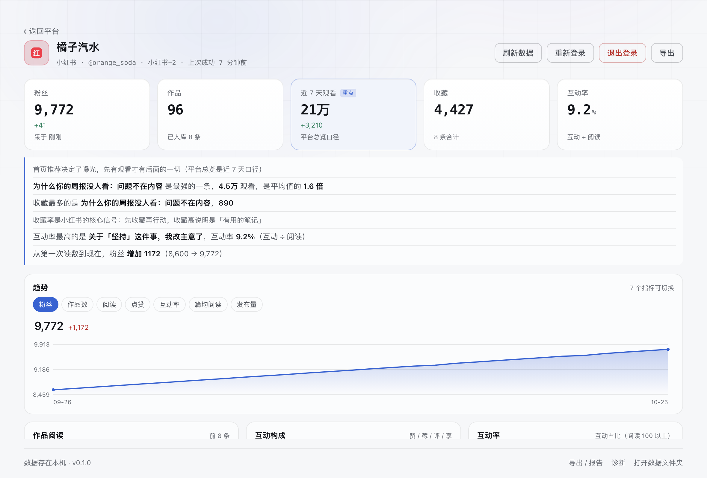

<p align="right"><strong>简体中文</strong> | <a href="README.en.md">English</a></p>

# 账号监控 · Account Monitor

    

> 作者：**Labulaka**（GitHub [@labulaka-ai](https://github.com/labulaka-ai)）· 公众号「**时空AI深水区**」

[下载安装](#下载安装) · [为什么做这个](#为什么我做这个) · [它做什么](#它做什么) · [一个号一个环境](#一个号一个环境) · [刻意不做的事](#它刻意不做的事) · [数据在哪](#数据存在哪) · [从源码跑](#从源码跑) · [技术选择](#技术选择) · [可信度](#可信度测试与实测) · [已知限制](#已知限制) · [许可证](#许可证)

一个**完全本地运行**的多平台账号数据留底工具。给同时运营好几个平台、又不想把数据交给任何第三方的人用：

**12 个平台、一个号一个独立浏览器环境、数据只存在你自己电脑上。**

公众号 · 小红书 · 抖音 · 视频号 · 微博 · 知乎 · B站 · X · YouTube · Instagram · Threads · TikTok

<a href="https://github.com/labulaka-ai/account-monitor/releases/download/v0.1.1/promo-am-v1.mp4"></a>

> 30 秒概念片，点图看完整版（5.6 MB，有声）。片子里是设计示意；**下面两张是真实界面截图**。

<picture>
  <source media="(prefers-color-scheme: dark)" srcset="docs/home-dark.png">
  
</picture>

<picture>
  <source media="(prefers-color-scheme: dark)" srcset="docs/platform-dark.png">
  
</picture>

> 截图里的账号、昵称、数字全部是合成样例，不是任何真人的数据。

---

## 下载安装

到 [Releases](https://github.com/labulaka-ai/account-monitor/releases) 下载对应版本，拖进「应用程序」：

| 你的机器 | 下哪个 |
|---|---|
| Apple 芯片（M1/M2/M3/M4） | `account-monitor-0.1.1-mac-arm64.dmg` |
| Intel 芯片 | `account-monitor-0.1.1-mac-x64.dmg` |

不确定就点左上角苹果菜单 →「关于本机」，看「芯片」那一行。

**第一次打开会被 macOS 拦下来**，因为安装包没有 Apple 开发者签名（签名要 99 美元/年，个人项目没买）。这不是软件坏了。两种解法，任选一种：

```bash
# 解法一：命令行去掉隔离标记（推荐，一次就好）
xattr -dr com.apple.quarantine /Applications/账号监控.app
```

解法二：在「应用程序」里**右键**点它 →「打开」→ 再点一次「打开」。之后就能正常双击了。

只接受从本仓库 Releases 下载的包，并建议核对一下哈希：

```bash
shasum -a 256 ~/Downloads/account-monitor-0.1.1-mac-arm64.dmg
```

SHA-256 写在对应 Release 的说明里。

## 为什么我做这个

平台后台的数字是**流动的**——昨天的阅读量、上周的粉丝数，过几天就被新数据盖掉。做内容的人真正想知道的是「三个月前那条到底跑了多少」「这个月比上个月好在哪」，但后台只给你看当下。

于是只能靠截图和表格手工记，结果是：

- **数字对不上**：同一条内容在创作者中心、数据看板、手机端三处显示的阅读量能不一样，隔一周再看又变了，最后不知道该信哪个；
- **跨平台没法比**：七个平台七套后台，想回答「同样的选题在哪个平台更吃香」，得挨个截图拼在一起，而且截完就过期了；
- **数据不在自己手里**：几乎所有第三方工具都要你把账号授权给它的服务器，登录态交出去之后，你能看到什么、它能看到什么，完全不对等。

这个工具只做一件事：**每天把各平台后台的数字抄一遍，存在你自己的硬盘上。** 于是「三个月前那条跑了多少」变成一次查询，「哪个平台投入产出比最高」变成一张图。

## 它做什么

| 能力 | 说明 |
|---|---|
| **12 个平台读数** | 每个平台一个适配器，读账号主页数字 + 作品列表 + 逐条作品的阅读/点赞/收藏/评论/分享。认不出的字段留空，不猜 |
| **每日快照** | 粉丝、累计阅读、累计点赞、作品数按天存一条，趋势图画的是真历史，不是重新采样 |
| **逐条作品留底** | 标题、发布时间、每次读到的指标都留着；已被平台删掉的作品标 `gone`，不当作从没存在过 |
| **自动分析要点** | 每个平台按它自己的口径给结论（例如小红书看收藏率、公众号看推荐占比），不是套同一套模板 |
| **报告导出** | Markdown / HTML / Word（`.docx` 手写生成，不依赖 Office） |
| **MCP 服务** | 可选，默认关闭。打开后本机 AI 可以读你的数据做分析，只监听 `127.0.0.1` + Bearer token |
| **深浅色** | 跟随系统，也可手动锁定 |

## 一个号一个环境

每个账号独占一个 Electron session 分区（`persist:acct-<平台>-<序号>`），Cookie、localStorage、缓存完全隔离。

这不是「为了方便多开」，是为了**防止串号**。同一个浏览器环境里先后登两个号，数据会混在一起，而且是那种看不见的错——**数字是真的，但属于另一个号**，光看数字永远发现不了。

所以除了分区隔离，还有两层：读数前先比对**身份锚点**（昵称 + uid/头像，第一次读到时锁定），对不上就不写库；界面上账号卡和详情页都印「昵称 · @handle」，随时能用人眼确认这张卡是哪个号。

## 它刻意不做的事

这几条是设计红线，写进代码也写进文档：

| 不做 | 为什么 |
|---|---|
| **不自动登录** | 登录只由你本人完成。不填表、不点通行密钥、不猜密码 |
| **不自动发布 / 点赞 / 关注** | 任何「帮你操作账号」的行为都可能触发风控。这是账号安全，不是技术做不到 |
| **不做高频轮询** | 每个平台有硬性最小间隔（抖音/小红书 20 分钟，其余 15 分钟），开了页面就计时。被节流时界面不报错，只告诉你「还差几分钟」 |
| **不上传任何数据** | 没有服务端、没有账号体系、没有埋点。断网可用 |

节流不是客气：平台后台对高频访问的判定是黑盒，一次触发可能要养很久。宁可少读几次。

## 数据存在哪

| 环境 | 位置 |
|---|---|
| 用 `npm start` 跑 | 项目内 `data/monitor.db` |
| 打包后的 App | `~/Library/Application Support/account-monitor/data/monitor.db` |

数据库是单文件 SQLite（Node 内置 `node:sqlite`，不需要装任何东西）。**备份就是复制这一个文件**；迁移前会自动在同级目录留一份时间戳备份。

账号的 Cookie 不在这里——它们在各平台的分区目录（`…/Partitions/acct-*`）下，由 Chromium 自己管理，删掉对应分区等于退出那个号的登录。

## 从源码跑

需要 Node 22.5+（`node:sqlite` 从这版开始有）。

```bash
git clone https://github.com/labulaka-ai/account-monitor.git
cd account-monitor
npm install     # 只装 electron，没有别的运行时依赖
npm start
```

首次打开是空的。点平台卡片 → 右侧面板会打开该平台后台 → **你自己登录** → 点「刷新数据」。

### 打包成 App

```bash
npm run check:pack        # 检查个人数据是否已隔离（data/、screenshots/ 不能进包）
npm run clean:personal    # 挪走个人目录
npm run dist:mac          # 出 arm64 + x64 两个 dmg
npm run restore:personal  # 挪回来
```

打包前那一步不是形式主义：`.app` 是要发给别人的，里面一旦带上 `data/`，就是 13 个账号的作品、粉丝数、分区路径，以及诊断文件里的平台页面原文。详见 [PACKAGING.md](PACKAGING.md)。

## 技术选择

**零运行时依赖。** 除了 Electron 本身，不引任何第三方包：

- 数据库：Node 内置 `node:sqlite`
- Excel / Word：手写 ZIP + XML（`lib/zip.js`、`lib/xlsx.js`、`lib/docx.js`）
- PDF：交给 Chromium 自己的 `printToPDF`
- MCP 服务：手写 JSON-RPC over stdio

为什么这么抠：这类工具要能放三年还能跑。依赖越少，三年后 `npm install` 失败的概率越低。副作用是安装包小、没有 native 编译、不用担心供应链投毒。

## 可信度：测试与实测

`npm test` 跑 **7 个套件、171 项断言**，全部是真实数据库和真实判定逻辑，不做 mock：

| 套件 | 项数 | 守什么 |
|---|---|---|
| `run.js` | 57 | 数据库迁移、导出、报告、格式化等主干行为 |
| `sync.test.js` | 34 | 读数结果怎么写库：新增、更新、判删、状态回写 |
| `scripts.test.js` | 29 | 平台取数脚本的顶层变量约束（注入页面执行，不能引用外部变量） |
| `reader.test.js` | 14 | 读数判定矩阵：**平台报 5 条读到 5 条但缺 3 条**这类情况不能判删 |
| `diag_pack.test.js` | 13 | 诊断包脱敏：昵称、handle、uid、家目录必须被替换 |
| `report.test.js` | 9 | 报告里的数字口径与空值处理 |
| `maintain.test.js` | 7 | 日常维护：清日志、VACUUM、备份 |

写这些测试的过程里，抓到的都是**不报错但结果错**的问题，几个典型：

- **「读到的条数」被当成「平台的总条数」**：一批视频当场被判成已删除，库里数据全标 `gone`。现在总数读不到就留空，绝不拿条数顶替；
- **一次空读数把粉丝数冲成 0**：面板开着停了 8 秒顺手读一次，全部字段都空，界面看起来就是一次假掉粉。现在「一次读数里所有指标都空 → 什么都不写」；
- **总数比实际读到的还小**：分类相加、头部计数都可能算出小于实际条数的「总数」，`读到的 >= 总数` 恒真，翻页判定彻底失效。现在这种总数不予采信；
- **`0` 和「没读到」混用**：平台确认是 0 个作品，是有效事实；读不到是未知。界面上一个是 `0`，一个是 `—`，混了就会误判。

## 已知限制

- **YouTube 在 Electron 里登不上**（Google 拒绝非标准浏览器）。用设置里的「从 Chrome 导入登录态」。
- 部分平台的单条指标读不到，界面显示 `—`（不是 0，是平台不给）。每个平台的能力声明在 `lib/adapters/platforms.js` 的 `caps` 里。
- **只实测过 macOS**。Windows / Linux 的构建配置在 `package.json` 里，但没跑过。
- 平台改版会让读数失效。失效时不会乱写数字：读不到就留空，界面上标「待核对」，点「诊断」能看到当次抓到的接口和页面原文。
- App 显示名是「账号监控」，数据目录却用英文名 `account-monitor`。改成中文会让老用户的数据「消失」，所以没动。

## 目录结构

```
main.js              Electron 主进程（窗口、面板、IPC、读数调度）
preload.js           上下文隔离桥
lib/
  adapters/          平台定义（加平台改这里一个数组）
  platforms/         各平台取数脚本，一个平台一个文件（注入页面执行）
  reader.js          读数编排 + 逐页对账
  sync.js            读数结果写库
  scheduler.js       每日自动更新
  report.js          报告生成（md / html / docx）
ui/                  前端（零构建，原生 JS）
mcp/server.js        MCP 服务，让 AI 读你的数据
scripts/             图标生成、打包前清理个人数据
```

### 加一个平台

在 `lib/platforms/` 新建一个文件，导出一个 `pages` 数组，再到 `lib/collectors.js` 的 `MODULES` 里加一行。别的平台不用碰。

**每个页面脚本都会被 `toString()` 后注入平台页面单独执行**，所以函数体不能引用文件外的任何变量——连本文件里的 `const` 也不行。这条约定由 `test/scripts.test.js` 守着。

## 许可证

[PolyForm Noncommercial 1.0.0](LICENSE) —— **可以自用，不允许商用**。

**允许**：自己用、随便改、分享给朋友自用；个人学习研究、兴趣项目、教学、慈善 / 公共研究 / 政府机构使用。

**不允许**：任何商业用途。卖这个软件、拿它收费提供服务、或者放进公司的业务流程里省成本，都算商业用途。

两点要说清楚：

- **不要求你公开自己的改动**（这点和 AGPL 正好相反），改了可以自己留着；
- **这不是 OSI 认定的「开源」**。源码公开可读，但「开源」有明确门槛，这里不冒充。

需要商业授权请单独联系作者。**作者本人不受这些限制**，可自商用，也可另签商业许可。

为什么是这条：这个工具的价值就在于「账号数据留在这台电脑上」。一旦被人打包成 SaaS 卖，用户的登录态就成了别人的资产。禁商用挡的是这条路，不是挡你自己用。
